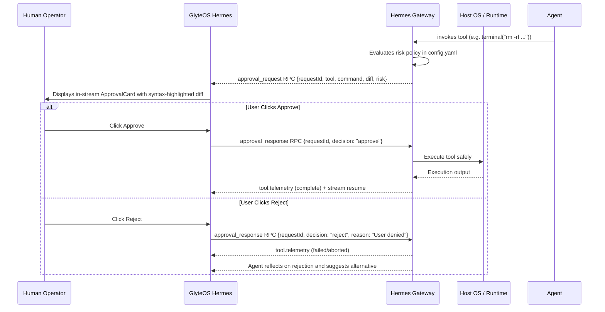

# Human-In-The-Loop Interactive Approvals Guide

> **Product**: GlyteOS Hermes  
> **Organization**: [GlyteTech](https://glyte.tech)

Human-In-The-Loop (HITL) approval is a core safety pillar of GlyteOS Hermes. When the agent attempts sensitive or mutating system actions, it suspends execution and generates a cryptographically signed approval ticket displayed in the stream.

---

## 1. Approval Lifecycle



---

## 2. Protected Tool Categories

The following tools trigger mandatory approval by default:

| Tool Name | Risk Level | Description |
|-----------|------------|-------------|
| `terminal` | High | Arbitrary shell execution (`rm`, `chmod`, `curl \| bash`, `sudo`) |
| `patch` | Medium | Unified diff modifications to repository files |
| `write_file` | Medium | Overwriting or creating critical system or source files |
| `cronjob` | High | Registering recurring scheduled cron tasks |
| `git_push` | High | Remote repository mutations |

---

## 3. Configuring Risk Thresholds

Custom allowlists and rules can be set in `~/.hermes/config.yaml`:

```yaml
security:
  command_allowlist:
    # Read-only commands that bypass approval prompts:
    - "git status"
    - "git diff*"
    - "ls -la"
    - "cat *"
    - "pnpm check-types"
    - "npm run test"

  command_blocklist:
    # Commands that are unconditionally rejected:
    - "rm -rf /"
    - "mkfs*"
    - "dd if=*"
    - "*shutdown*"

  approval_timeout_seconds: 180 # Auto-aborts if not answered within 3 minutes
```

---

## 4. In-Stream Approval Card Features in GlyteOS Hermes

- **Syntax-Highlighted Diff**: Added lines in emerald (`+`), deleted lines in rose (`-`), context in cyan.
- **Risk Badge**: High (Crimson), Moderate (Amber), Low (Emerald).
- **Execution Target**: Shows target working directory, affected file path, or exact shell command.
- **Keyboard Shortcuts**: `Ctrl + Enter` to approve, `Esc` to reject.
