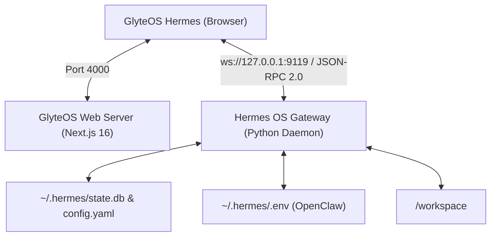

# GlyteOS Hermes - Installation Guide

> **Product**: GlyteOS Hermes  
> **Organization**: [GlyteTech](https://glyte.tech)  
> **Target**: 100% Native WebUI Replacement for Nous Hermes Agent

This guide covers deploying GlyteOS Hermes via **Docker** (recommended for production) and **Bare-Metal Linux** (ideal for development and headless VPS environments).

---

## Architecture Overview

GlyteOS Hermes is completely decoupled from heavy external databases (PostgreSQL, Redis, Drizzle) and cloud auth providers. It connects directly to the self-hosted Hermes OS Gateway over JSON-RPC 2.0 WebSockets (`ws://127.0.0.1:9119`).



---

## Method 1: Docker Compose Deployment (Recommended)

### Prerequisites
- Docker Engine 24.0+ & Docker Compose v2.20+
- Host Hermes Agent running (`hermes gateway` or `hermes serve`)

### Steps

1. **Clone the Repository**:
   ```bash
   git clone https://github.com/keshavsharma/Glyte-hermes-os.git
   cd Glyte-hermes-os
   ```

2. **Configure Environment**:
   Copy `.env.example` to `target-ui/.env.local`:
   ```bash
   cp target-ui/.env.example target-ui/.env.local
   ```
   Ensure `HERMES_WEBUI_PASSWORD` is configured:
   ```env
   HERMES_GATEWAY_URL="ws://host.docker.internal:9119"
   HERMES_WEBUI_PASSWORD="your-strong-password"
   PORT=4000
   ```

3. **Start GlyteOS Hermes**:
   ```bash
   docker compose up -d --build
   ```

4. **Verify Deployment**:
   ```bash
   docker compose ps
   curl -I http://localhost:4000
   ```

5. **Access the Web Interface**:
   Navigate to `http://localhost:4000` and authenticate using your `HERMES_WEBUI_PASSWORD`.

---

## Method 2: Bare-Metal Linux Setup (Debian / Ubuntu / macOS)

### Prerequisites
- Node.js 20.x or 22.x LTS
- `pnpm` (Corepack enabled: `corepack enable && corepack prepare pnpm@latest --activate`)
- Python 3.10+ (for Hermes Agent backend)

### 1. Install & Configure Hermes Core
If you haven't already installed Hermes Agent:
```bash
curl -fsSL https://hermes-agent.nousresearch.com/install.sh | bash
source ~/.bashrc
hermes doctor
```

Launch the Hermes Gateway daemon on loopback port 9119:
```bash
hermes gateway --port 9119 --host 127.0.0.1
```

### 2. Install GlyteOS Hermes Client
```bash
cd /opt/glyte-hermes-os/target-ui
pnpm install --frozen-lockfile
```

### 3. Build & Run Production Bundle
```bash
pnpm build
PORT=4000 pnpm start
```

### 4. Setup Systemd Service (Optional for Production Linux)
Create `/etc/systemd/system/glyte-hermes.service`:
```ini
[Unit]
Description=GlyteOS Hermes AI OS Client
After=network.target

[Service]
Type=simple
User=root
WorkingDirectory=/opt/glyte-hermes-os/target-ui
Environment=NODE_ENV=production
Environment=PORT=4000
Environment=HERMES_GATEWAY_URL=ws://127.0.0.1:9119
Environment=HERMES_WEBUI_PASSWORD=your_secure_password
ExecStart=/usr/local/bin/pnpm start
Restart=always
RestartSec=5

[Install]
WantedBy=multi-user.target
```

Enable and start the service:
```bash
sudo systemctl daemon-reload
sudo systemctl enable --now glyte-hermes
sudo systemctl status glyte-hermes
```
